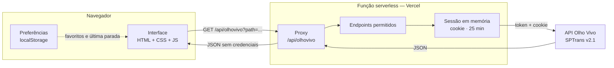
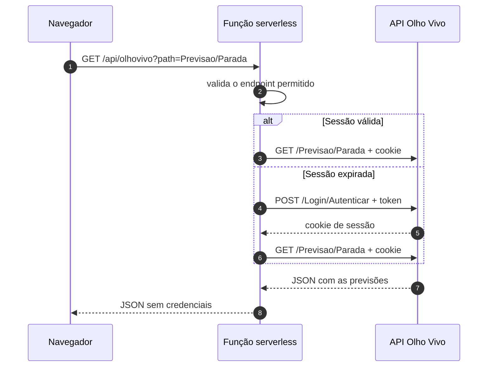

<h1 align="center">🚌 Ponto Certo</h1>

<h3 align="center">Chegadas de ônibus em São Paulo com a API Olho Vivo da SPTrans</h3>

<p align="center">
  
  
  
  
  
  
  
</p>

<p align="center">
  Global Solution 2026.2 · Application Development · FIAP
</p>

---

## Visão geral

Em São Paulo, quem depende de ônibus conhece a cena: chegar ao ponto e não saber se o próximo veículo vem em dois minutos ou em meia hora. O **Ponto Certo** transforma os dados abertos da SPTrans em uma resposta direta — quanto falta, qual linha, de onde ela vem e onde o ônibus está agora.

Construído do zero com **HTML, CSS e JavaScript puro**, sem framework de front-end e sem etapa de build. A única peça em execução no servidor é uma função serverless que protege o token de acesso e conversa com a API Olho Vivo.

### O que o app resolve

| A dor de quem espera | O que o app entrega |
| --- | --- |
| Não saber quando o ônibus chega | Previsão oficial ordenada pela próxima chegada, com horário previsto |
| Informação espalhada em vários lugares | Um painel único por ponto, com todas as linhas que passam ali |
| Não saber onde o veículo está | Mapa com a posição real dos ônibus de cada linha |
| Uso rápido na rua | Layout mobile, tema escuro de alto contraste e atualização automática |
| Falta de informação sobre acessibilidade | Selo de veículo acessível em cada previsão |

### Fluxo de uso

1. **Busque** o ponto por nome ou endereço.
2. **Escolha** o ponto na lista — o painel abre com as linhas e as previsões.
3. **Acompanhe** os minutos, o horário previsto e a acessibilidade de cada veículo.
4. **Salve** o ponto nos favoritos para abrir com um clique na próxima vez.

## Funcionalidades

| Recurso | Descrição |
| --- | --- |
| Busca de pontos | Pesquisa por nome ou endereço direto na base da SPTrans, com ordenação por distância quando a localização é permitida |
| Painel de chegadas | Linhas do ponto ordenadas pela próxima chegada, horário previsto e selo de veículo acessível |
| Atualização automática | Consultas a cada 30 segundos com contador regressivo, atualização manual e pausa quando a aba fica em segundo plano |
| Favoritos | Pontos salvos no navegador (`localStorage`) para acesso com um clique |
| Mapa interativo | Localização do ponto e posição dos ônibus de cada linha no mapa (Leaflet + OpenStreetMap) |
| Responsivo e acessível | Layout para celular e desktop, navegação por teclado, foco visível e suporte a `prefers-reduced-motion` |
| Tratamento de concorrência | Requisições antigas não sobrescrevem buscas ou linhas selecionadas depois |

## Arquitetura

O app é organizado em três camadas com responsabilidades isoladas: a interface no navegador, uma borda autenticada na Vercel e a API oficial da SPTrans.

### Visão de componentes



### Ciclo de uma consulta



### Componentes

| Componente | Responsabilidade | Onde vive |
| --- | --- | --- |
| Interface | Busca, painel de chegadas, mapa e estados de carregamento | `index.html`, `css/styles.css`, `js/app.js` |
| Cliente da API | Monta a chamada ao proxy e traduz erros para o usuário | `js/api.js` |
| Preferências | Favoritos, última parada e atualização automática | `js/storage.js` + `localStorage` |
| Proxy | Recebe a consulta, valida o caminho e devolve o JSON | `api/olhovivo.js` |
| Núcleo Olho Vivo | Login, sessão, retentativa em 401/403 e expiração da sessão | `api/_lib/olhovivo.js` |
| Servidor local | Reproduz o proxy e serve os estáticos em desenvolvimento | `server.js` |

### Limites de confiança

| Fronteira | O que atravessa | Proteção |
| --- | --- | --- |
| Navegador → proxy | `path` e parâmetros de consulta | Lista de endpoints permitidos e resposta sem credenciais |
| Proxy → SPTrans | Token e cookie de sessão | Variável de ambiente e memória do processo |
| Cliente | Apenas dados públicos | O token nunca chega ao JavaScript do navegador |

A API Olho Vivo exige **token** e uma **sessão por cookie**. O navegador nunca fala com a SPTrans diretamente: a função serverless faz o login, mantém a sessão em memória e repassa as consultas autenticadas.

**Por que o proxy existe:**

1. **Segurança** — o token fica apenas nas variáveis de ambiente do servidor, nunca no código entregue ao navegador.
2. **CORS** — a API da SPTrans não aceita chamadas diretas de qualquer origem; o navegador conversa apenas com a mesma origem do app.
3. **Sessão** — login e cookie são centralizados no servidor, sem expor credenciais ao cliente.

### Stack

| Camada | Tecnologia | Papel no projeto |
| --- | --- | --- |
| Interface | HTML5 · CSS3 · JavaScript (ES Modules) | Página única, componentes renderizados no DOM e estado controlado sem framework |
| Mapas | Leaflet + OpenStreetMap | Mapa interativo com marcadores personalizados e tema escuro |
| Back-end | Node.js na função serverless da Vercel | Proxy autenticado, sessão em memória e lista de endpoints permitidos |
| Persistência | `localStorage` | Favoritos, última parada aberta e preferência de atualização automática |
| Deploy | Vercel | Site estático na raiz e função em `api/`, sem build |
| Desenvolvimento | Node.js 22.9+ | Servidor local que reproduz o comportamento de produção |

### API Olho Vivo

| Uso no app | Endpoint |
| --- | --- |
| Buscar pontos por nome ou endereço | `GET /Parada/Buscar?termosBusca=` |
| Previsão de chegadas do ponto | `GET /Previsao/Parada?codigoParada=` |
| Posição dos ônibus de uma linha | `GET /Posicao/Linha?codigoLinha=` |
| Login (somente no servidor) | `POST /Login/Autenticar?token=` |

## Como rodar localmente

| Requisito | Versão |
| --- | --- |
| Node.js | 22.9 ou superior |
| Token da SPTrans | Obtido em [Meus Aplicativos](https://www.sptrans.com.br/desenvolvedores/) |

O projeto não possui dependências para instalar.

1. Crie o arquivo de ambiente e informe o token:

   ```bash
   cp .env.example .env
   ```

   ```env
   OLHO_VIVO_TOKEN=cole_seu_token_aqui
   ```

2. Inicie o servidor:

   ```bash
   npm run dev
   ```

3. Abra <http://localhost:3000>.

O `server.js` entrega os arquivos estáticos e responde `/api/olhovivo` com a mesma lógica da função da Vercel. Para usar outra porta: `PORT=3100 npm run dev` (no PowerShell: `$env:PORT=3100; npm run dev`).

### Problemas comuns

| Situação | Solução |
| --- | --- |
| A página abre, mas a busca falha | Use `npm run dev` e acesse `http://localhost:3000`, ou a URL publicada; abrir o `index.html` direto não tem o proxy |
| `EADDRINUSE` na porta 3000 | Encerre o processo que usa a porta ou rode `PORT=3100 npm run dev` |
| Erro de autenticação na SPTrans | Confira `OLHO_VIVO_TOKEN` no `.env` (local) ou nas variáveis da Vercel; após alterar, faça Redeploy |
| Ponto sem previsões | O veículo pode estar sem GPS ou fora de operação; tente outro ponto |

## Deploy na Vercel

1. Envie o projeto para um repositório no GitHub:

   ```bash
   git init
   git add .
   git commit -m "Ponto Certo: app com a API Olho Vivo"
   git branch -M main
   git remote add origin https://github.com/SEU-USUARIO/ponto-certo.git
   git push -u origin main
   ```

2. Em [vercel.com](https://vercel.com), use **Add New → Project** e importe o repositório.
3. Framework Preset: **Other**. Build Command e Output Directory ficam vazios.
4. Em **Environment Variables**, adicione `OLHO_VIVO_TOKEN` com o seu token.
5. Clique em **Deploy** e abra a URL `https://seu-projeto.vercel.app`.

> **Antes de publicar:** confirme que o `.env` não foi enviado ao repositório, que a variável `OLHO_VIVO_TOKEN` está configurada e que o preset é **Other**.

A Vercel detecta o site estático na raiz e a função em `api/`. Ao trocar o token, atualize a variável e faça **Redeploy**.

## Estrutura do projeto

```
index.html              Página única do app
css/styles.css          Tema escuro e layout responsivo
js/app.js               Estado, painel, busca, mapa e atualização automática
js/api.js               Chamadas ao proxy /api/olhovivo
js/storage.js           Favoritos e preferências no localStorage
api/olhovivo.js         Função serverless (proxy)
api/_lib/olhovivo.js    Login, sessão e consultas à API da SPTrans
server.js               Servidor local de desenvolvimento
.env.example            Modelo da variável de ambiente
PARTICIPANTES.txt       Integrantes e divisão do trabalho
```

## Engenharia e qualidade

| Área | Práticas aplicadas |
| --- | --- |
| Segurança | Token restrito ao servidor, lista de endpoints permitidos e `.env` fora do Git |
| Resiliência | Contadores de versão contra respostas atrasadas e nova autenticação automática em 401/403 |
| Acessibilidade | Marcos semânticos, ARIA, foco visível, link "pular para o conteúdo" e `prefers-reduced-motion` |
| Desempenho | Sem framework e sem build, consultas a cada 30 segundos, polling pausado em aba oculta e Leaflet via CDN |
| Experiência | Esqueleto de carregamento, contador de atualização e mensagens de erro em português |

## Limitações

- As previsões dependem dos dados enviados pelos veículos; pontos sem GPS podem ficar sem previsão.
- A atualização automática é de 30 segundos para não sobrecarregar a API pública.
- Os favoritos ficam apenas no navegador — não há cadastro de usuários.
- A sessão da API é mantida por instância da função serverless; em produção, cada instância faz seu próprio login.

## Equipe

Os integrantes e a divisão do trabalho estão em [`PARTICIPANTES.txt`](PARTICIPANTES.txt).

## Créditos

- Dados de transporte: [SPTrans — API Olho Vivo](https://www.sptrans.com.br/desenvolvedores/)
- Mapas: [OpenStreetMap](https://www.openstreetmap.org/copyright)
- Biblioteca de mapas: [Leaflet](https://leafletjs.com/)

Projeto acadêmico desenvolvido para a Global Solution 2026.2 da FIAP, sem fins comerciais.
